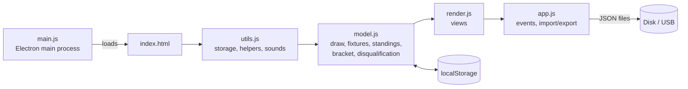

# Tournament Management System

**Offline desktop app that runs a football or volleyball tournament end to end: draw, fixtures, standings, knockout bracket and champion.**

[](https://github.com/arslannizzetali/turnuva-yonetim-sistemi/actions/workflows/ci.yml)
[](LICENSE)


🇹🇷 [Türkçe README](README.tr.md)

<!-- TODO(izzet): add screenshots (setup wizard, draw, standings, bracket, champion screen) to docs/screenshots/ and reference them here. -->

## Why this project?

School and amateur tournaments are often run with paper brackets or spreadsheets, often in sports halls with no reliable internet. This app lets an organiser set up a tournament in three steps and run it on a single laptop: it handles the draw, fixtures, live standings, byes, forfeits and the knockout bracket, and keeps everything on the local machine.

<!-- TODO(izzet): say who it was built for (e.g. a school or club tournament, a client), whether it was used at a real event, and how many teams. -->

## Features

- **Setup wizard** — sport (football / volleyball) → format (groups + knockout, or straight knockout) → teams and group settings
- **Draw** — optional animated draw with sound, or an instant draw
- **Group stage** — single round-robin fixtures (circle method) and a live standings table
- **Knockout bracket** — automatic byes for team counts that are not a power of two (group leaders get the byes first), plus a special rule when three teams remain (one bye straight to the final)
- **Moderator panel** — disqualify a team: played matches are kept, unplayed matches become walkovers for the opponent and the bracket updates
- **Team locking** — teams are editable until the first match is played
- **Detailed scores** — football regulation / extra time / penalties; volleyball sets; optional goals and cards for top-scorer and discipline tables
- **Print / PDF** — A4-ready printouts
- **JSON backup** — export/import one tournament or the whole database, e.g. via USB stick
- **Champion screen** — trophy and confetti

### Scoring rules

| Sport | Win | Draw | Loss | Tiebreakers |
| --- | --- | --- | --- | --- |
| Football | 3 | 1 | 0 | Goal difference, goals scored, name |
| Volleyball | 3 (3-0 / 3-1), 2 (3-2) | — | 0 (0-3 / 1-3), 1 (2-3) | Set difference, sets won, name |

## Tech stack

| Choice | Why |
| --- | --- |
| Electron | One portable `.exe` that runs on any Windows PC without installation |
| Vanilla JavaScript, HTML, CSS | No framework or CDN, so the app works fully offline and stays small |
| `localStorage` + JSON export | Simple persistence on the organiser's machine, easy to back up |
| Web Audio API | Draw sound effects without bundling audio files |
| `node:test`, ESLint, Prettier, GitHub Actions | Tests for the tournament logic; CI builds the Windows app |

Security settings: `contextIsolation`, `sandbox`, no Node integration in the renderer, a Content Security Policy, blocked new windows and disabled DevTools in the packaged app.

## Architecture



All tournament rules live in `js/model.js` and are pure functions over a tournament object, which is what the tests exercise.

## Getting started

Requirements: Node.js 22.

```bash
npm install
npm start
```

Build the portable Windows app:

```bash
npm run build:win   # -> dist/TurnuvaYonetimSistemi-Portable.exe
```

CI also builds the `.exe` on every push and attaches it to the workflow run as an artifact.

## Running tests

```bash
npm run lint
npm test
```

Tests load `utils.js` and `model.js` into an isolated Node VM (no Electron or DOM needed) and cover round-robin fixtures, group splitting, bye distribution, the three-team rule, football and volleyball standings, and disqualification in groups and knockouts.

## Project structure

```text
main.js           # Electron main process (window, menu, save-file dialog)
index.html        # App shell; all views are rendered here by JS
css/style.css     # UI styles
js/utils.js       # Helpers, localStorage, Web Audio
js/model.js       # Tournament logic
js/render.js      # Views and screen flows
js/app.js         # Event delegation, JSON import/export, bootstrap
js/logo-data.js   # Embedded top-bar logo (base64)
tests/            # node:test unit tests
```

## Known limitations and roadmap

- Windows build only; macOS/Linux builds are possible with electron-builder but not configured.
- Data lives in one machine's `localStorage`; use JSON export for backups.
- Imported JSON files are only lightly validated.
- `icon.ico` is a placeholder.
- Electron 31 and electron-builder 24 have published advisories fixed in newer major versions; an upgrade is planned.
- Roadmap: double round-robin option, schedule with dates and venues, head-to-head tiebreaker.

## AI-assisted development

<!-- TODO(izzet): describe which AI tools you used, at which stages, and what you designed yourself (tournament rules, bye/three-team logic, UI flow). -->

## License

[MIT](LICENSE)

## Contact

İzzet Ali Arslan — [GitHub](https://github.com/arslannizzetali)
